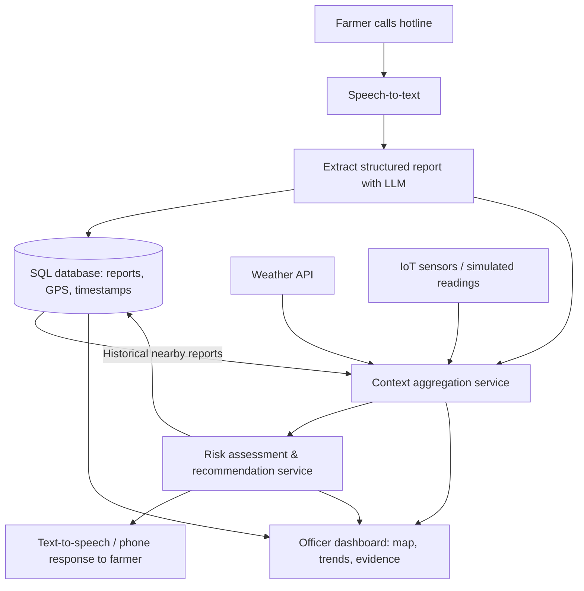

# Farmer Advisory & Early-Warning System

## 1. Concept

A farmer calls a hotline and describes an agricultural problem in natural language. The system transcribes the conversation, extracts structured information, and stores it in a SQL database. It then enriches the report with current weather, sensor measurements, and **previous reports from nearby farmers**. A recommendation engine assesses the evidence and proposes an appropriate countermeasure. The farmer receives an understandable voice response, while agricultural officers can view geographically located incidents, trends, and the data behind decisions on a dashboard.

## 2. System Architecture



## 3. Main Components

### A. Phone and voice interface
- Farmer describes a problem over the phone, ideally in their preferred language.
- Speech-to-text produces a transcript.
- An LLM extracts a structured report: problem category, description, symptoms, time, location, and any missing information.
- The system asks for a village or farm location if GPS coordinates are not already known; a phone call alone does not supply accurate GPS coordinates.
- Recommendations are read back using text-to-speech.

### B. SQL database
Stores historical and current reports, locations, supporting measurements, and recommendations. The database supports queries such as: **How many similar problems were reported within 5 km over the last 3 days?**

Suggested tables:

| Table | Important fields |
|---|---|
| `farmer_reports` | `id`, `created_at`, `problem_type`, `description`, `transcript`, `latitude`, `longitude`, `status` |
| `sensor_readings` | `id`, `recorded_at`, `sensor_id`, `latitude`, `longitude`, `metric`, `value`, `unit` |
| `weather_observations` | `id`, `observed_at`, `latitude`, `longitude`, `rainfall_mm`, `temperature_c` |
| `recommendations` | `id`, `report_id`, `risk_level`, `advice`, `evidence_summary`, `created_at` |

Record locations at an appropriate precision; limit access to personal data and obtain relevant consent.

### C. Context aggregation
For each incoming report:
1. Retrieve nearby reports with similar problem types from a defined recent time window.
2. Fetch relevant weather conditions and forecasts for the location.
3. Retrieve nearby sensor readings, noting age, distance, and quality.
4. Assemble a structured **decision context** with evidence, uncertainty, and sources.

### D. Recommendation engine
- Apply transparent rules to identify risk levels and possible next steps.
- Use an LLM to express recommendations clearly, not to invent measurements or confirm diagnoses.
- Highlight clusters of similar reports and escalate potentially serious incidents to an agricultural officer.
- Return a recommendation, supporting factors, confidence/uncertainty notes, and an alert level.

**Important:** Low-cost sensors such as turbidity, conductivity, temperature, or pH sensors provide indicators; they do **not** prove the presence or absence of pathogens or guarantee drinking-water safety.

### E. Geographic officer dashboard
- Map showing reports pinned by farm coordinates or approximate village location.
- Filters by problem type, severity, date range, and status.
- Charts showing reported problems over time and possible regional clusters.
- Detail view showing each report's relevant weather, nearby sensor measurements, comparable prior calls, and recommendation rationale.
- Officer workflow for investigating and updating incident status.

## 4. Proposed Technology Stack (Azure)

| Capability | MVP technology |
|---|---|
| Phone connectivity | Azure Communication Services, if telephony is available; browser microphone as fallback |
| Speech-to-text / text-to-speech | Azure AI Speech |
| Structured extraction and explanations | Azure OpenAI |
| Database | Azure SQL Database |
| API and aggregation | Python + FastAPI |
| Weather | Open-Meteo API |
| Water sensors | Python simulator; optionally ESP32 + physical sensors |
| Rules and recommendations | Python |
| Interactive officer dashboard | Streamlit + Folium / Plotly |
| Hosting | Azure App Service, or local containers for the demo |

For a 24-hour prototype, keep the backend as **one FastAPI application with modular components**, rather than separate deployed microservices.

## 5. Example End-to-End Scenario

1. A farmer calls: *“My crops have started dying since the heavy rains.”*
2. Speech recognition transcribes the report. An LLM structures it as a crop-health problem and records its reported location.
3. SQL history shows six similar reports within 5 km in the last three days.
4. Weather data shows heavy recent rainfall; nearby sensors show elevated turbidity (if available).
5. The recommendation engine flags a **possible regional water-related issue** and suggests inspection, appropriate testing, and officer follow-up rather than claiming a confirmed cause.
6. The farmer hears the recommendation over the phone.
7. The officer's dashboard displays the incident on a map, alongside the other reports and supporting evidence.

## 6. Parallel Workstreams — Team of 6

| Person | Ownership | Deliverable |
|---|---|---|
| 1 | Phone, transcription, information extraction | Voice input → structured JSON report; spoken response |
| 2 | SQL storage and geospatial queries | Schema, report persistence, nearby/history lookup |
| 3 | Weather and sensor ingestion | API adapter, simulated sensor stream, normalized measurements |
| 4 | Context aggregation and recommendation logic | Evidence-rich context JSON, risk rules, actionable advice |
| 5 | Map dashboard | Live report map, filters, trends, incident evidence panel |
| 6 | API integration, Azure setup, testing | Shared FastAPI contracts, deployment, end-to-end demo |

Agree on sample JSON payloads at the start so all six people can develop in parallel using mocks.

## 7. MVP API Contracts

| Endpoint | Purpose |
|---|---|
| `POST /reports` | Save an extracted farmer report |
| `GET /reports/nearby?lat=...&lon=...&radius_km=...` | Retrieve relevant historical reports |
| `GET /context/{report_id}` | Fetch combined report + weather + sensor + historical context |
| `POST /recommendations/{report_id}` | Create recommendation and save supporting evidence |
| `GET /dashboard/reports` | Supply geolocated incidents and dashboard filters |

Example report:

```json
{
  "problem_type": "crop_health",
  "description": "Crops started dying after heavy rainfall",
  "latitude": -1.2921,
  "longitude": 36.8219,
  "reported_at": "2026-10-16T14:30:00Z",
  "source": "phone_call"
}
```

## 8. Suggested 24-Hour Plan

| Time | Focus |
|---|---|
| Hours 0–2 | Agree on schemas, API contracts, one demo location and scenario |
| Hours 2–10 | Build six components independently with mocked responses |
| Hours 10–16 | Connect calls → SQL → context → recommendation → voice/dashboard |
| Hours 16–20 | Test incomplete locations, missing sensors, duplicate reports, error handling |
| Hours 20–24 | Stabilize demo, prepare pitch, rehearse farmer and officer journeys |

## 9. Success Criteria

- A farmer can submit a spoken report and receive a spoken recommendation.
- Report and approximate GPS location are persisted in SQL.
- Recommendations incorporate **previous nearby farmer calls** plus available weather/sensor evidence.
- The officer dashboard maps reports and explains the factors behind the recommendation.
- The system clearly separates **suspected risk** from **confirmed contamination or diagnosis**.
