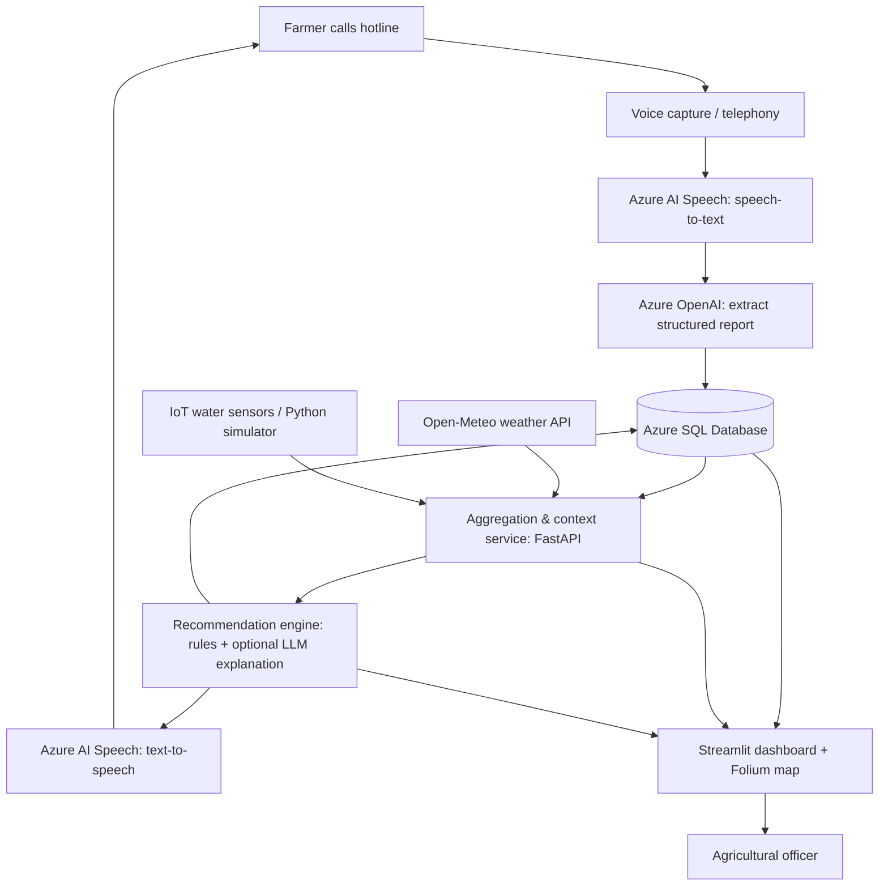

# Farmer Water Intelligence System — Architecture & Hackathon Plan

**Project:** BCG Platinion Hackathon  
**Team:** 6 people  
**Target:** Demonstrable end-to-end MVP in 24 hours  
**Architecture rating:** 9/10 for a hackathon MVP (assuming a simple, integrated implementation)

## 1. Concept

A farmer calls a hotline and explains an agricultural or water-related problem in natural language. The platform transcribes the call, extracts structured information, and saves the report in a SQL database with a timestamp and GPS location. A decision service then combines the new report with **previous nearby farmer reports**, weather data, and available water-sensor measurements. It assesses possible causes and recommends practical next steps. The recommendation is spoken back to the farmer, while officers see reports, alerts, and supporting evidence on a map-based dashboard.

**Key differentiator:** Use clusters of historical, geolocated farmer reports to identify emerging local problems—not just an isolated farmer's description.

## 2. System Architecture



### End-to-end workflow

1. **Call:** A farmer describes a problem (e.g., cloudy water or dying crops).
2. **Transcribe & classify:** Speech is converted to text; an LLM extracts a problem category, description, and reported location.
3. **Persist:** Save the raw transcript (subject to privacy controls), structured report, timestamp, and verified/confirmed location in SQL.
4. **Aggregate context:** Query similar reports nearby and within a recent time window; add available weather and sensor readings.
5. **Recommend:** Apply interpretable risk rules, then optionally use Azure OpenAI to express approved advice in clear language.
6. **Respond:** Convert the recommendation to speech for the farmer.
7. **Visualize:** Show reports, clusters, risk severity, time trends, sensor metrics, and weather evidence on the officer dashboard.

> **Important:** A phone call does not automatically provide trustworthy GPS coordinates. Ask for a village, a shared pin, or a previously registered farm location; mark the location's confidence/precision. Correlation between rainfall, reports, and sensor anomalies is not proof of contamination or disease.

## 3. Recommended Tech Stack

| Component | Technology | MVP note |
|---|---|---|
| Incoming call / voice interface | Azure Communication Services (if calling resources are enabled); otherwise browser microphone | Browser-based voice is the reliable fallback |
| Speech recognition & playback | Azure AI Speech (STT / TTS) | Test target language/accent early |
| Structured problem extraction | Azure OpenAI, structured JSON output | Validate output against a schema |
| Core API + aggregation | Python + FastAPI | **One backend application**, modular code |
| Relational database | Azure SQL Database | Store reports, readings, recommendations, alerts |
| Weather | Open-Meteo | Historical/current/forecast data as available |
| IoT | ESP32 + suitable water sensors, or Python simulator | Simulator is sufficient for MVP |
| Recommendation logic | Python rules; Azure OpenAI for explanation | Do not let LLM invent risk evidence |
| Dashboard | Streamlit + Folium (or Plotly for charts) | Interactive map, filters, alert panel |
| Hosting | Azure App Service for API; local Streamlit for demo | Deployment optional until integration works |
| Notification | Dashboard alerts | Email/SMS only as stretch goals |

**Why SQL:** The core data are structured reports, coordinates, timestamps, and linked observations. Azure SQL is a good match and supports spatial queries if implemented appropriately. For an MVP, a latitude/longitude bounding-box prefilter plus a distance calculation may be sufficient; SQL spatial types can come later.

## 4. Suggested Data Model

### `farmer_reports`

| Field | Example / purpose |
|---|---|
| `report_id` | Unique report ID |
| `created_at` | Timestamp |
| `problem_type` | `water_quality`, `crop_health`, `irrigation`, `other` |
| `description` | Structured problem summary |
| `transcript` | Original transcription, if retained |
| `latitude`, `longitude` | Confirmed or approximate coordinates |
| `location_precision` | `gps`, `village`, `unknown` |
| `severity` | `low`, `medium`, `high`, `unknown` |
| `status` | `open`, `reviewed`, `resolved` |

### Supporting tables

- **`sensor_readings`** — sensor ID, location, timestamp, measurement type, value, unit, sensor health/quality flag.
- **`weather_observations`** — location/time, rainfall, temperature, relevant forecast variables and source.
- **`recommendations`** — report ID, risk level, evidence summary, recommendation text, model/rule version, created time.
- **`alerts`** — report/location, severity, reason, status and officer acknowledgement.

For privacy, collect only essential contact/location data, restrict access, and avoid showing personal details on public maps.

## 5. API Contracts — Agree Before Coding

| Endpoint | Owner | Example responsibility |
|---|---|---|
| `POST /reports` | Backend / DB | Accept a validated structured report and save it |
| `GET /reports?bbox=...&since=...` | Backend / DB | Fetch geolocated reports for map/filtering |
| `GET /context/{report_id}` | Aggregation | Return weather, sensor and nearby-report context |
| `POST /recommendations/{report_id}` | Recommendations | Assess report, persist and return recommendation |
| `POST /voice/process` | Voice integration | Transcribe / extract farmer report (depending on implementation) |
| `GET /dashboard/summary` | Backend / dashboard | Return map markers, totals, alerts and trends |

**Shared structured report JSON example:**

```json
{
  "problem_type": "water_quality",
  "description": "Water became cloudy after heavy rainfall",
  "latitude": -1.2921,
  "longitude": 36.8219,
  "location_precision": "village",
  "reported_at": "2026-10-16T14:30:00Z"
}
```

These coordinates are **illustrative dummy data**, not a farmer's real location.

## 6. Parallel Tasks — Team of Six

All six can begin in parallel **after a short kickoff to agree on field names, JSON schemas, fake example data and API contracts**.

| Person | Workstream | Concrete MVP deliverable | Can start with |
|---|---|---|---|
| **1** | Voice interface & extraction | Speech → transcription → validated structured report; speech response | Mock backend POST endpoint and sample recording |
| **2** | Azure SQL + data model | Schema, seeded nearby reports, CRUD + geospatial/time-window queries | Agreed report JSON |
| **3** | Weather + IoT | Open-Meteo client, simulated sensor measurements, normalized context JSON | Sample GPS coordinates |
| **4** | Aggregation + recommendations | Merge problem, historic nearby calls, weather, sensors; score severity and produce actionable advice | Mock context responses |
| **5** | Dashboard & map | Streamlit/Folium map with markers/clusters, severity filtering, weather/sensor evidence and officer alerts | Seeded JSON dataset |
| **6** | Backend integration + deployment | FastAPI app structure, API contract, repository, environment config, Azure setup and end-to-end tests | Mock endpoint implementations |

**Integration ownership:** Person 6 owns the shared API contract and integration; each workstream owner supplies a tested function/route and sample payload. Avoid six separately deployed microservices.

## 7. 24-Hour Execution Plan

| Time | Goal |
|---|---|
| **Hours 0–2** | Freeze one demo scenario, agree on schema/endpoints, set up repo, secrets and mock JSON |
| **Hours 2–10** | Parallel coding across six workstreams; test each module using mocks |
| **Hours 10–16** | Integrate voice → SQL → context → recommendations → speech + dashboard |
| **Hours 16–20** | Test edge cases: missing GPS, no sensor, duplicate reports, contradictory evidence, offline/invalid readings |
| **Hours 20–24** | Feature freeze; improve demo reliability, slides and pitch; rehearse live demo |

### Must-have MVP

- Voice input (browser microphone acceptable) and speech-to-text.
- LLM or schema-based extraction of a structured problem and location.
- SQL persistence of reports and seeded historical examples.
- Nearby report search and weather/simulated-sensor enrichment.
- Transparent risk rules with a practical, uncertainty-aware recommendation.
- Spoken output plus geolocated officer dashboard showing evidence used.

### Stretch goals

Physical ESP32 sensors, actual phone-number integration, multilingual voice experience, automatic SMS/email alerts, advanced hotspot detection, offline buffering.

## 8. Demo Scenario

1. Farmer says: **“The water became cloudy after the heavy rain, and my crops look unhealthy.”**
2. Voice pipeline extracts `water_quality` and the reported/confirmed farm location.
3. SQL returns **six sample nearby reports within 5 km in the past three days** (seeded demo data).
4. Weather API indicates recent rainfall; simulated sensor data shows elevated turbidity.
5. Recommendation service flags a **suspected regional water-quality issue** and advises the farmer to use an alternative safe water source where possible, seek testing, and contact an agricultural officer. It does **not** claim to confirm pathogens or chemical contamination.
6. Farmer hears a short response; the officer dashboard displays the new report, nearby report cluster, rainfall trend, sensor reading and alert status.

**Success criterion:** One coherent end-to-end experience where the spoken recommendation and map evidence match what was saved and evaluated by the system.

## 9. Important Design Constraints

- **Accuracy:** pH, conductivity, temperature and turbidity may indicate anomalies, but they do not reliably identify all pathogens, pesticides or specific contaminants. Mark data quality and recommend confirmatory testing.
- **Connectivity:** Assume rural connectivity can be limited. Buffer sensor readings locally if real hardware is used; demonstrate the concept with a simulator.
- **Power:** Real deployments need low-power measurement cycles, sleep modes and battery/solar design.
- **Language/accessibility:** Keep spoken replies short and test recognition in the intended local languages.
- **Location/privacy:** Require confirmation of farmer location; minimize personal data exposure and avoid exact farm coordinates on public dashboards.
- **Recommendation safety:** Use approved/rule-based countermeasures and show evidence plus uncertainty; escalate high-risk events to a human officer.

---

**Guiding principle:** Build a dependable **data-to-action pipeline**, not a complex set of microservices. The main innovation is integrating **historical, location-aware farmer calls** with environmental evidence to detect potentially emerging regional issues.
